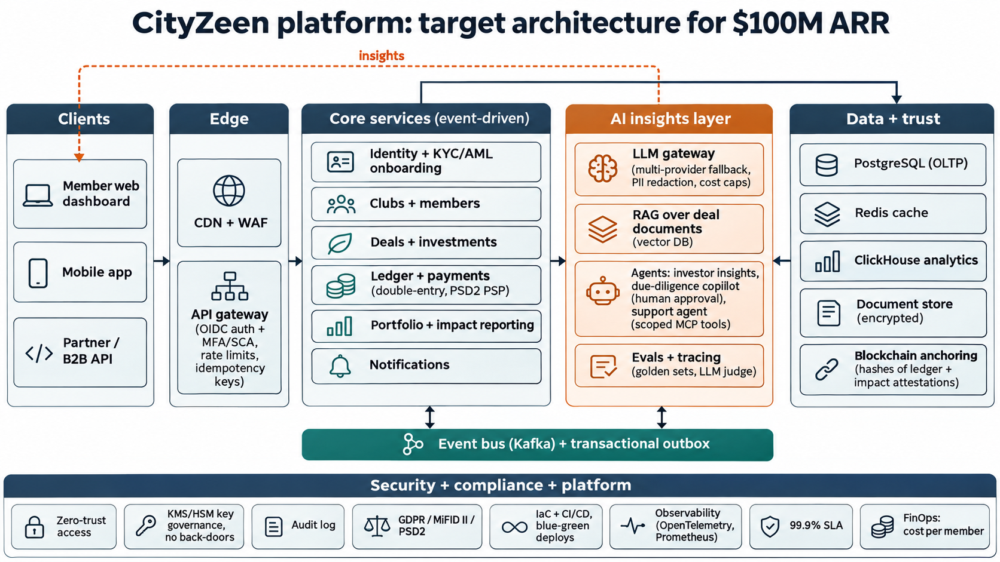

# CityZeen: technical blueprint for $100M ARR

One-page technical blueprint by Maxim Popelnitskiy for the Head of Engineering - AI Stack role at CityZeen. It covers how to scale the platform to $100M ARR, with a focus on clients and AI-driven insights.

- **PDF (one page):** [CityZeen-Technical-Blueprint.pdf](CityZeen-Technical-Blueprint.pdf)
- **Architecture diagram:** below

